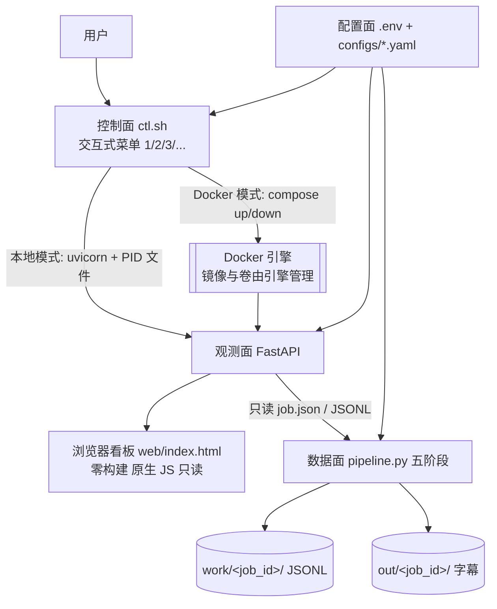

# 09 · 控制面、浏览器看板与部署

> 新增于 2026-11-08 00:46 的项目会话。本文件落地用户追加的 U-1 ~ U-6 目标。
> 与既有文档的关系：**数据面契约仍以 `03` 为准**；本文件只定义「运维形态」（怎么启动、怎么观测、怎么部署）。
> 若 `00` 的非目标、`02` 的架构件、`07` 的 ADR 与本文件冲突，以本文件 + `07` 新增 ADR 为准，旧条目标记 Superseded，不改写历史结论。
>
> **2026-11-09 修订（U-7~U-10，完整设计见 `10`）**：§1 目标表新增 U-7~U-10；§4「看板只读」与 §5「写操作留 M3」是否放宽取决于 D-16（方案 A 下保持不变）；§7 的模型挂载改为 `./models` bind mount，原分句由 ADR-012 取代；§8 忽略规则改为 `models/*` + 放行 `README.md`；新增待决项与风险见 `10 §12` 与 `07`。模型目录、识别 / 下载 / 删除以 `10` 为准。

## 1. 新增目标与不变红线

| 编号 | 用户目标（2026-11-08 追加） | 落地方式 |
|---|---|---|
| U-1 | 一个脚本执行后，通过输入选择来开启 / 关闭 / 查看服务状态，不做复杂参数启动 | `ctl.sh` 交互式菜单，纯数字选择，无参数 |
| U-2 | 前端为浏览器运行看板 | `src/cueloom/web/index.html` 零构建单页 + FastAPI 只读 API |
| U-3 | 先分析设计、配置环境与环境变量文件（如 LLM API） | 本文件 + `pyproject.toml` + `.env.example` + `configs/` |
| U-4 | 每次操作完，只要有新工作区文件未追踪，就提交推送一次 | 阶段粒度提交：设计 / 环境 / 框架 / 验证各一次，见 §8 |
| U-5 | 甚至可以 Docker 部署 | `Dockerfile` + `docker-compose.yml` + `.dockerignore`，见 §7 |
| U-6 | 不把 Docker 产物放到本机里；测试后若开启服务必须及时关闭 | 框架阶段不 build / 不 up；本地冒烟后立即 stop 并校验端口释放，见 §9 |
| U-7 | 模型目录与项目目录在一起，不放系统目录 | `<root>/models/` 唯一资产根；显式本地路径加载，见 `10` |
| U-8 | 软件自动识别该目录下已有模型 | 扫描 + 四态完整性判定 + manifest，见 `10 §6` |
| U-9 | 一键下载 / 删除 / 查看的模型工作台 | `ctl.sh` 菜单 10 + 看板模型卡片，见 `10 §7`~`§9` |
| U-10 | 不改变纯数字菜单、零构建、无复杂参数 | 工作台沿用既有交互范式 |

**不变红线（不得借「做看板」放宽）**：

1. 输出只有字幕文件，不烧录 / 不 mux / 不生成视频 / 不下载视频。
2. 时间码永不交给 LLM；LLM 只处理 `{id, text}`，按 id 回填。
3. 自有 OpenAI 兼容 LLM 服务是唯一翻译后端，不集成第三方翻译 API。
4. 五阶段 JSONL 落盘、`cue.id` 稳定、`pipeline.py` 是唯一业务入口。
5. Python 用 `uv` 在项目目录管理；密钥只从环境变量 / `local.yaml` 读取。

**被修订的条款**：

| 原条款 | 修订 |
|---|---|
| `00 §5` N-4「桌面 GUI、Web UI（Streamlit/Gradio 一律不引入）」 | 仍禁止 Streamlit / Gradio / 桌面 GUI / 前端框架；**允许一个零构建的原生 HTML 运维看板**，只展示状态与产物，不编辑字幕、不承载业务逻辑 |
| `07` ADR-002「不实现 GUI」 | 仅该部分由 ADR-010 取代；「只出字幕文件」仍然有效 |
| `07` ADR-006「M3 才加 FastAPI」 | 服务层与看板提前到框架阶段（ADR-009），但仍是薄封装，不引入队列 / 数据库 / 鉴权中间件 |

## 2. 分层架构



四层职责：

| 层 | 组件 | 职责 | 禁止 |
|---|---|---|---|
| 控制面 | `ctl.sh` | 启动 / 停止 / 重启 / 状态 / 日志 / 环境初始化 / Docker 模式 | 不解析业务参数、不碰流水线逻辑 |
| 观测面 | `server.py` + `web/index.html` | 健康检查、配置摘要、job 列表、产物清单、静态页面 | 不写业务状态、不生成字幕、不引数据库 |
| 数据面 | `pipeline.py` + `stages/` | 五阶段生成字幕 | 不感知 HTTP / PID / 菜单 |
| 配置与产物面 | `.env` / `configs/` / `work/` / `out/` | 密钥、参数、中间产物、最终字幕 | 密钥不入库、不进镜像、不进日志 |

## 3. 统一入口 `ctl.sh`

**唯一人工入口**：执行 `./ctl.sh` 后显示菜单，输入数字即可，不需要记忆参数。

| 选择 | 动作 | 说明 |
|---|---|---|
| 1 | 启动服务 | 检查端口与 PID → 加载 `.env` → `uv run uvicorn cueloom.server:app` → 写 PID |
| 2 | 停止服务 | SIGTERM → 等待 → 必要时 SIGKILL → 删除 PID 文件 |
| 3 | 查看状态 | PID 存活 + `/api/health` + 监听地址 + 版本 + LLM 配置是否齐全（脱敏） |
| 4 | 重启服务 | 2 → 1 |
| 5 | 查看日志 | `tail -n 80` 服务日志，或跟随模式 |
| 6 | 初始化环境 | `uv sync`；若 `.env` 不存在则从 `.env.example` 复制并提示填写 |
| 7 | Docker 模式 | 子菜单 up / down / status / logs；**明确提示会在 Docker 引擎侧产生镜像，需用户另行确认** |
| 8 | 运行一次流水线 | M1 实现后接 `cueloom run`，框架阶段显示「未实现」 |
| 9 | 测试 LLM 连接 | 显式发起一次 2 条 cue 的最小探活请求，只返回结果类别，不打印密钥 |
| 0 | 退出 | — |

实现约定：

- PID 文件 `work/ctl/server.pid`，日志 `work/ctl/server.log`，均落在已忽略的 `work/` 下。
- 启动前检查端口占用；已有 PID 且进程存活时拒绝重复启动。
- 停止必须等待进程真正退出并删除 PID 文件；脚本退出时若曾启动服务，必须在结束前关闭（U-6）。
- 默认监听 `127.0.0.1:8000`；改地址只通过 `.env` 的 `CUELOOM_HOST` / `CUELOOM_PORT`，不通过命令行参数。
- 脚本用 `#!/usr/bin/env bash` + `set -euo pipefail`，所有路径基于脚本所在目录解析，可从任意 cwd 执行。

## 4. 浏览器看板

- **零构建**：单文件 `web/index.html`，内联 CSS 与原生 JS，不引入 npm / Node / Vite / React / CDN 依赖（离线可用、无前端构建产物）。
- **只读**：通过 `fetch` 定时（默认 5 s）拉取 `/api/status` 与 `/api/jobs`；一期不提供提交任务、编辑字幕、删除产物等写操作。
- **展示内容**：服务健康与运行时长、监听地址、版本、配置摘要（ASR / 对齐 / LLM 后端与模型名，**密钥只显示「已配置 / 未配置」**）、LLM 探活结果、job 列表与状态、每个 job 的产物文件名与大小、最近质检 error/warn 数。
- **主题**：跟随系统深浅色；无外部字体与图片，避免网络依赖。
- **安全**：默认只绑定回环地址；公网暴露须显式设置 `CUELOOM_HOST=0.0.0.0` 并自行加反向代理鉴权（D-11）。产物接口只白名单返回 `out/<job_id>/` 下的字幕文件，禁止目录穿越。

## 5. 服务层（FastAPI 薄封装）

| 方法 | 路径 | 返回 | 说明 |
|---|---|---|---|
| GET | `/` | HTML | 静态看板 |
| GET | `/api/health` | `{ok, version, uptime_sec}` | 存活探针，compose healthcheck 用 |
| GET | `/api/status` | 配置摘要 + 依赖/LLM 探活 | 脱敏，不含 api_key 值 |
| GET | `/api/jobs` | job 摘要数组 | 扫 `work/*/job.json`，不引数据库 |
| GET | `/api/jobs/{id}` | 单个 job 详情 | id 白名单校验 |
| GET | `/api/jobs/{id}/artifacts` | 产物文件名 / 大小 | 只读，不返回音频与中间 wav |

- `POST /jobs`、任务取消、日志流等写能力留到 M3，且必须复用 `pipeline.run(job)`，不得在路由里写业务逻辑（ADR-006 精神保留）。
- 不引 Celery / Redis / 数据库 / 鉴权中间件；单进程 uvicorn，与 CLI 共用同一 `Config` 与 `pipeline`。
- 日志不打印完整字幕正文与 API key；`/api/status` 的 LLM 探活结果只给布尔值与错误类别。

## 6. 配置与环境变量（U-3）

文件分层（优先级从高到低）：

```
ctl.sh 菜单选择 > 环境变量 / .env > configs/local.yaml（忽略） > configs/default.yaml > 代码默认值
```

`.env.example`（可提交）字段：

| 变量 | 必填 | 示例 / 默认 | 说明 |
|---|---|---|---|
| `CUELOOM_LLM_BASE_URL` | 是 | `https://your-llm.example.com/v1` | OpenAI 兼容端点，不以 `/chat/completions` 结尾 |
| `CUELOOM_LLM_API_KEY` | 是 | `sk-...` | **只在 `.env` 中填，禁止入库** |
| `CUELOOM_LLM_MODEL` | 是 | `your-model` | 写进缓存 key |
| `CUELOOM_HOST` | 否 | `127.0.0.1` | 默认仅本机 |
| `CUELOOM_PORT` | 否 | `8000` | |
| `CUELOOM_LOG_LEVEL` | 否 | `INFO` | |
| `CUELOOM_LLM_CONCURRENCY` | 否 | `4` | |
| `CUELOOM_LLM_QPM` / `CUELOOM_LLM_TPM` | 否 | 空 | D-06 待用户提供 |

- `.env` 由 `ctl.sh` 菜单 6 从 `.env.example` 复制生成，已在 `.gitignore` 中排除；`configs/local.yaml` 同样排除。
- `config.py` 启动时校验必填项；服务启动前做一次轻量 LLM 探活（2 条 cue 的最小请求），失败只报类别，不打印密钥，看板显示「LLM 不可用」。
- 缺少配置时服务仍可启动（看板可见、流水线不可用），避免「为了看状态必须先配好密钥」。

## 7. Docker 部署（U-5 / U-6）

- `Dockerfile`：基于 `ghcr.io/astral-sh/uv` 官方镜像，先复制 `pyproject.toml` / `uv.lock` 做依赖层缓存，再复制源码；`uv sync --frozen`；非 root 用户；`CMD` 启动 uvicorn。
- `docker-compose.yml`：单服务，`env_file: .env`（本机存在、不入库），`ports` 由 `CUELOOM_HOST` / `CUELOOM_PORT` 控制；`healthcheck` 打 `/api/health`。
- **产物隔离（2026-11-09 修订，见 `10 §11` / ADR-012）**：`work/` 与 `out/` 仍用 Docker **named volume**；**模型权重改为 `./models:/app/models` 的 bind mount**，使容器内与本机共用同一批项目内模型资产（U-7）。U-6 禁止的是镜像 / 容器 / 构建缓存 / 卷等 Docker 产物落进工作区，模型是用户主动下载的资产，不属此类；但容器内下载会写回本机 `models/`，菜单 7 必须提示。是否改用 named volume 留 D-17，两种模式不可同时启用。
- `.dockerignore`：排除 `.git/`、`.venv/`、`work/`、`out/`、`models/`、`.env`、`.agents/`、`.workbuddy/`、`*.log`、`*.tar`，避免把密钥与本机产物打进构建上下文或镜像。
- **U-6 执行约定**：框架阶段**只提交上述配置文件，不执行 `docker build` / `docker compose up`**，避免本机留下镜像、构建缓存与容器。`ctl.sh` 菜单 7 会在真正构建前二次确认，并把 `down` 与 `up` 成对提供；测试结束必须 `down`。
- 镜像是否推送 registry、何时构建，登记为 D-12，未确认前不执行。

## 8. 忽略与阶段提交约定（U-4）

必须忽略（`.gitignore`）：`.venv/`、`uv` 缓存、`__pycache__/`、`.pytest_cache/`、`.ruff_cache/`、`work/`、`out/`、**`models/*`（例外放行 `!models/README.md`）**、`.env`、`.env.*`（除 `.env.example`）、`configs/local.yaml`、`*.log`、`*.tar`、`docker-compose.override.yml`、`.docker/`、`.agents/blackboard.md`、`.workbuddy/`、`.DS_Store`。模型权重另有 `*.bin` / `*.safetensors` / `*.gguf` / `*.onnx` / `*.pt` 全局忽略做双保险（U-7 / R-13）。

必须提交：`pyproject.toml`、`uv.lock`、`ctl.sh`、`Dockerfile`、`docker-compose.yml`、`.dockerignore`、`.env.example`、`configs/default.yaml` 与 prompt / glossary 模板、`configs/model-catalog.yaml`（M0.6）、`src/`、`tests/`、`docs/`、**`models/README.md`**。

**U-4 执行规则**：每完成一个阶段（设计 / 环境 / 框架 / 验证）立即 `git status`；只要出现新文件或未追踪产物，就 `git add` + `commit` + `git push` 一次。提交信息写清阶段；密钥、本机产物、模型权重、黑板不得进入提交。

## 9. 测试与关闭约定（U-6）

1. `uv sync` + `uv run pytest` 最小测试（单测不加载模型、不访问真实 LLM、**不下载真实权重**；模型工作台测试用小型假模型目录，见 `10 §13`）。
2. 本地启动 uvicorn → `curl /api/health` 与 `/` → 查看看板返回 200 → **立即停止**，确认 PID 文件删除、端口不再监听。
3. 不启动 Docker，不构建镜像；如用户日后要求 Docker 实测，必须先说明会产生的引擎侧产物，测完 `docker compose down -v` 并清理镜像，且不在本机项目目录留下任何文件。
4. 每次测试结论按协同规范单行追加 `.agents/blackboard.md`；黑板不进 git。

## 10. 新增待决项

| 编号 | 问题 | 建议 | 影响面 |
|---|---|---|---|
| D-11 | 看板是否允许公网暴露 / 鉴权方式 | 默认仅 `127.0.0.1`，公网走反向代理，一期不做内置鉴权 | 安全、compose ports |
| D-12 | Docker 镜像是否发布到 registry、何时构建 | 未确认前只提交配置，不 build / 不 push | 部署流程、U-6 |
| D-13 | 看板是否需要触发任务 / 取消任务 | 一期只读，写操作留 M3 | API 契约 |
| D-14 | `ctl.sh` 是否需要非交互模式供 CI 使用 | 暂不需要；如需要只加一个 `status` 子命令，不引入参数体系 | 控制面 |
| D-15 | `models/` 是否保留占位说明 | 是，`models/README.md` 入库 | 目录骨架 |
| D-16 | 模型工作台用方案 A 还是 B | 先 A（控制台操作 + 看板只读），确认后再叠加 B | ADR-010、写接口 |
| D-17 | Docker 模型用 bind mount 还是 named volume | 建议 `./models` bind mount | compose、U-6 语义 |
| D-18 | 是否支持自定义 / 私有模型与 HF token | 一期不支持，手工放入的标 `unmanaged` | 注册表、删除白名单 |

D-15~D-18 的完整背景与取舍见 `10 §12`；统一登记在 `07 §4`。
