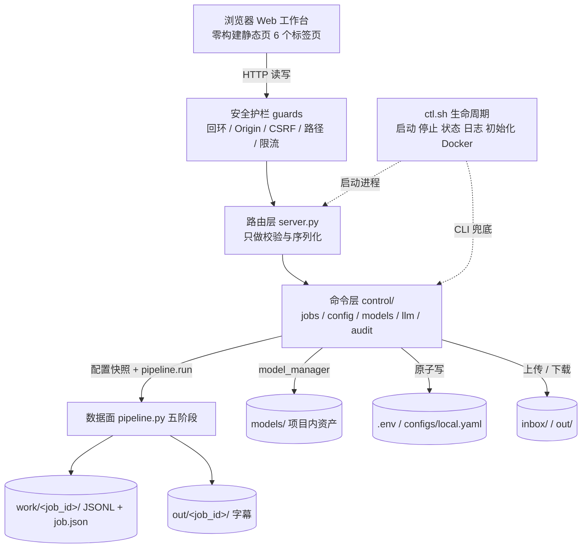

# 12 · 统一 Web 工作台（浏览器为默认操作面）

> 新增于 2026-11-09 的项目会话，落地用户追加的 U-11 ~ U-13 目标。
> **编号说明**：`11` 已预留给 M2 首版评测报告（见 `08 §4`），故本文编号 `12`。
> 本文只定义**设计**；命令层、写接口、前端标签页与 `ctl.sh` 调整留到 M0.7（§14）。
> 与既有文档的关系：数据面契约仍以 `03` 为准，模型资产的目录 / 扫描 / 下载 / 删除护栏仍以 `10` 为准；**运维形态与交互入口以本文 + `07` 新增 ADR 为准**。冲突处把旧条目标记 Superseded 或加修订注记，不改写历史结论。

> **2026-11-09 用户确认修订（ADR-017 优先）**：D-19 改为本机自动通过、非本机 token，固定密码方式预留；默认仍回环，显式远程模式有强制鉴权与加密传输要求。§11 原「非回环直接拒绝」已被替代，不能继续按该旧条款实现。D-23 允许按职责拆分前端，不设三个文件上限。D-20 仍待确认，说明见下。

### D-20 补充：浏览器的文件与服务端的文件不是同一处

- **上传**：在浏览器点选文件，把浏览器所在设备的文件传到服务端 `inbox/`。本机使用会多一次复制；另一台电脑或手机访问时，这是传入其文件的正常方式。大文件需要上传耗时与磁盘配额。
- **授权媒体目录**：在部署配置里明确授权服务所在机器的某个媒体目录，网页只列该目录内文件并提交不透明素材 id；无需把视频再复制进项目，适合本机大文件或服务器媒体库。服务端必须做路径包含与符号链接检查，不能让远端网页自行新增授权根。
- **任意绝对路径**：网页输入 `/Users/.../video.mp4`，指的是服务所在机器，不是访问者电脑；Docker 下也只认识容器内路径。范围过大容易读到无关文件，不建议开放。
- **推荐组合（尚待用户确认）**：上传 + 本机配置的授权媒体目录；任意绝对路径不开放。Docker 如要用媒体目录需显式只读挂载，不能挂整个 Home 或项目。

### D-19 / D-23 实施补充

本机免登录按实际 TCP 回环对端判断，不相信客户端 Host/Origin 或未经信任的代理头，局域网地址不等于本机。代理/Docker 来源不明时要求 token。远程鉴权必须覆盖业务读取、写入与下载，不只保护按钮。固定密码只预留登录契约，实际启用前需完成加盐哈希、限速、会话过期与注销；无默认密码。token 不进 URL/日志，远程凭证只经 HTTPS 或安全隧道传输。默认仍本机监听，不自动开放局域网。

前端使用独立 CSS 与按页面/职责划分的原生 JS 模块，文件数量服从可维护性，不设人为上限；保留零构建约定。以下旧方案中的「三个文件」只作示例，不再是限制。

## 1. 定位变更：看板与工作台是同一个东西

用户澄清（2026-11-09）：所谓「看板」与「工作台」并非两个组件，而是**一个集成在浏览器里的操作界面工具**。在该界面内要能完成：发起工作流并拿到输出、修改配置、模型管理、API 管理。

| 编号 | 用户目标（2026-11-09 追加） | 落地方式 |
|---|---|---|
| U-11 | 看板 / 工作台合一，浏览器是默认操作面 | 单一零构建页面，多标签页；不再区分「只读看板」与「控制台工作台」 |
| U-12 | 在浏览器进行工作流输出 | 上传 / 选择素材 → 发起五阶段流水线 → 轮询进度 → 查看并下载字幕产物 |
| U-13 | 在浏览器修改配置，含模型管理与 API 管理 | 配置表单（业务参数）、LLM 连接表单（含密钥与探活）、模型列表（查看 / 下载 / 删除 / 设为默认） |

**这不是新增功能，而是控制面主入口的迁移**：

| | 旧形态（`09` / `10` 方案 A） | 新形态（本文） |
|---|---|---|
| 主操作面 | `ctl.sh` 纯数字菜单 | 浏览器 Web 工作台 |
| 看板 | 只读观测（`GET` only） | 读写一体，观测只是其中一个标签页 |
| 运行流水线 | 菜单 8 / `cueloom run` | 页面「运行」标签页；CLI 保留为兜底 |
| 改配置 | 手改 `.env` / `configs/local.yaml` | 页面表单，服务端校验后原子写回 |
| 模型管理 | 菜单 10（方案 A） | 页面「模型」标签页（`10 §9` 方案 B） |
| `ctl.sh` 角色 | 唯一人工入口 | **只管服务生命周期与环境初始化**（启动 / 停止 / 状态 / 日志 / Docker / 初始化），以及无浏览器时的 CLI 兜底 |

**不变红线**：输出只有字幕文件；时间码永不交给 LLM；自有 OpenAI 兼容服务是唯一翻译后端；五阶段 JSONL 与 `cue.id` 稳定；`pipeline.run(job, cfg)` 仍是唯一业务入口；密钥不入库、不进镜像、不回显；零构建、无复杂参数启动；测试后必须关闭服务。

## 2. 冲突矩阵

| 既有条款 | 冲突点 | 处理 |
|---|---|---|
| `00 §2`「命令行优先」、`02` P-5、`ADR-001`/`ADR-006` | 浏览器成为默认操作面 | **局部 Superseded**：CLI / Python API 仍是一等公民且可独立跑完整流水线，但不再是默认交互方式；`pipeline.py` 与传输层解耦的结论继续有效 |
| `ADR-009`「`ctl.sh` 是唯一人工入口」 | 出现第二个入口 | **局部 Superseded**：`ctl.sh` 退为「服务生命周期入口 + 兜底」；浏览器承担服务运行后的全部业务操作。两者不得各自实现一套业务逻辑（§4 命令层） |
| `00` N-4 / `ADR-010`「零构建只读看板、写操作留 M3」、`09 §4/§5`、`D-13` | 需要写接口 | `ADR-010` 标 **Superseded（ADR-014）**：放宽为「零构建可写工作台」；**零构建 / 无 npm / 无框架 / 无 CDN** 四条不变。D-13 结清为「需要，提前到 M0.7」 |
| `10 §9` 方案 A / B、`D-16` | 上轮建议先 A | **D-16 结清为方案 B**：浏览器可写；`10 §4~§8` 的目录、注册表、扫描、下载、删除护栏全部复用，只是入口从菜单换成页面 |
| `ADR-013`「模型管理属控制面，写操作不进数据面」 | 入口位置变了 | **结论保留**：模型写操作仍只作用于 `models/`，仍由 `model_manager` 承接，不碰 `work/` / `out/` / `job.json` / `pipeline.run()`；「只绑回环」由 §11 进一步收紧 |
| `00` N-6「一期不做鉴权」、`D-11`、`R-11`/`R-18` | 写接口能改密钥、跑任务、删模型，风险等级完全不同 | 不做账号体系 / 多租户（N-6 不变），但必须增加**单机防跨站最小防护**：回环强制、Origin/Host 校验、自定义头、可选本地令牌（ADR-016）。D-11 收窄为「是否额外启用令牌」 |
| `09 §6`「配置由人工编辑文件」、`config.py` 模块级 `CFG` 单例 | 表单写回后要即时生效 | 新增配置提供器与「写回 → 同步进程环境 → 重建 Config」链路；运行中的 job 使用**配置快照**（§8） |
| `09 §7` / `ADR-011` / `10 §11` Docker | 容器内 `env_file` 注入的是环境变量，不是可写文件；浏览器写 `.env` 不会持久化 | 容器模式下配置写接口返回 `read_only_mode`（§12），不假装写成功；是否支持写回留 D-25 |
| `02 §9`「不引入前端」 | 需要交互界面 | 精确化为「不引入前端框架 / 构建工具 / CDN」；静态文件仍由 FastAPI 直接托管（§5） |

## 3. 代码级现状核对（2026-11-09）

| 事实 | 位置 | 对设计的影响 |
|---|---|---|
| `server.py` 只有 5 个 `GET`，模块级 `CFG = load_config()` 在 import 时读一次配置 | `server.py:19` | 必须改为可刷新的 `ConfigProvider`；否则浏览器改配置后 `/api/status` 永远显示旧值 |
| `config.py` 用 `load_dotenv(env_file, override=False)`，且 `_env()` 优先读 `os.environ` | `config.py:103,116-120` | **最关键陷阱**：`ctl.sh` 启动时 `set -a; source .env`，把这些值注入了进程环境；之后即使改写 `.env`，`load_config()` 仍返回旧环境值。必须同时清理 / 更新本进程拥有的 `CUELOOM_*` 键 |
| `pipeline.run(job, cfg)` 显式接收 `cfg`；`translate._get_client(cfg)` 每次运行构造客户端 | `pipeline.py:78`、`translate.py:82` | 可天然实现「job 级配置快照」：发起任务时冻结一份 Config，运行中改配置不影响该任务 |
| `job.json` 每阶段原子写，已有 `status` / `stage` / `stage_results` | `pipeline.py:67-75` | 进度轮询直接复用，不需数据库；但要处理服务被杀后残留 `running` 状态 |
| `.env` 当前权限 `0644`，含注释与空值行 | 本机实测 | 浏览器写入密钥后必须改为 `0600`，且写回要保留注释与未知键 |
| `.dockerignore` 排除了 `.env` / `.env.*`，但**未排除 `configs/local.yaml`** | `.dockerignore` | 本地覆盖若含密钥会进构建上下文；本轮补忽略规则（§13） |
| `ctl.sh` 菜单 8/9 直接调 CLI 与 `probe`；菜单 10 尚未实现 | `ctl.sh:116-146` | CLI 与页面必须共用同一命令层，避免 `align.backend` 那类「显示值 ≠ 实现」重演（R-24） |
| `docker-compose.yml` 仍把 `models` 挂 named volume | `compose:14` | M0.6 未开工，尚未按 `10 §11` 改成 `./models` bind mount；本轮不改代码，只在 §12 记录依赖 |

## 4. 统一架构：四层 + 命令层

| 层 | 组件 | 职责 | 禁止 |
|---|---|---|---|
| 生命周期层 | `ctl.sh` | 服务进程、PID/日志、uv 环境、Docker 模式、打印工作台地址与令牌 | 不解析业务参数、不实现第二套配置 / 模型逻辑 |
| 交互层 | `web/index.html` + `app.js` + `style.css` | 表单、按钮、进度轮询、二次确认、错误展示 | 不直接读文件、不缓存密钥、不引外部资源 |
| 路由层 | `server.py` | 参数校验、统一错误封装、调用命令层 | **不写业务逻辑、不直接改文件、不直接跑 pipeline** |
| 命令层 | `src/cueloom/control/` | `job_service` / `config_service` / `model_service` / `llm_service` / `task_registry` / `audit` / `guards` | 不引数据库 / 消息队列 / Celery；内存任务表即可 |
| 数据面 | `pipeline.py` + `stages/` | 五阶段生成字幕 | 不感知 HTTP / PID / 菜单 |

命令层是本次新增的关键一层：它让 `ADR-006`「路由只调 `pipeline.run`」的精神在写接口时代仍然成立，也让 `ctl.sh` 菜单 8/9/10 与浏览器共用同一套服务，杜绝两套口径。

## 5. 前端形态（零构建的演进）

现状是 118 行单文件 `index.html`（内联 CSS/JS、5 秒轮询）。加入 6 个标签页与表单后，单文件会膨胀到难以维护，因此：

| | 方案 A：坚持单文件 | 方案 B：拆成 3 个静态文件（推荐，D-23） |
|---|---|---|
| 文件 | `web/index.html`（约 700+ 行） | `web/index.html` + `web/app.js` + `web/style.css` |
| 构建 | 无 | 无 |
| 托管 | 现有 `HTMLResponse` 读文件 | `GET /` 读 HTML，`/static/*` 用 Starlette `StaticFiles`（FastAPI 已带，无新依赖） |
| 代价 | 单文件难 diff、难测试 | 多两个文件；需给 HTML 加两个本地引用 |

两方案都**不引入** npm / Node / Vite / React / Vue / CDN / 外链字体，离线可用。标签页建议：`概览`（健康 / 配置摘要 / 活跃任务）、`运行`（素材 + 参数 + 发起 + 进度 + 产物）、`配置`（业务参数）、`API`（LLM 连接 + 探活）、`模型`（列表 + 下载 / 删除 / 设为默认）、`产物与日志`（job 列表、字幕下载、服务日志尾部）。导航用 URL hash，不引路由库；概览与活跃任务仍 5 秒轮询，不引 WebSocket。

## 6. API 契约总表

统一响应：成功直接返回对象 / 数组；失败返回 `{"error": {"code": "...", "message": "...", "hint": "..."}}`，`code` 取值见 §11。所有 `POST` / `PUT` / `DELETE` 都经过 `guards`（§11）。

| 方法 | 路径 | 说明 | 状态 |
|---|---|---|---|
| GET | `/`、`/api/health`、`/api/status`、`/api/jobs`、`/api/jobs/{id}`、`/api/jobs/{id}/artifacts` | 现有只读接口 | 已有 |
| GET | `/api/config` | 可编辑配置 + 字段 schema + `editable` / `restart_required` / 来源标记；**密钥只给布尔值** | 新增 |
| PUT | `/api/config` | 白名单字段批量校验后原子写回（§8） | 新增 |
| POST | `/api/config/reload` | 从磁盘重建 Config 并同步进程环境 | 新增 |
| POST | `/api/llm/probe` | 用当前配置发一次最小探活，只返回 `{ok, category, latency_ms, model}` | 新增 |
| GET | `/api/inbox` | 已上传素材列表（名称 / 体积 / 时间） | 新增 |
| PUT | `/api/inbox/{name}` | 流式上传素材，写 `inbox/`（§7） | 新增 |
| DELETE | `/api/inbox/{name}` | 删除素材，需回传文件名确认 | 新增 |
| POST | `/api/jobs` | 发起流水线，返回 `{job_id, status}`，后台线程执行 | 新增 |
| GET | `/api/jobs/active` | 当前活跃任务与进度摘要 | 新增 |
| GET | `/api/jobs/{id}/artifacts/{name}` | 字幕文件下载（`FileResponse`，后缀白名单 + 路径包含校验） | 新增 |
| GET | `/api/models` | 模型 manifest（四态 + 体积 + 是否默认） | 新增 |
| POST | `/api/models/rescan` | 强制重扫 `models/` | 新增 |
| POST | `/api/models/{id}/download` | 启动下载，返回 `task_id` | 新增 |
| POST | `/api/models/{id}/verify` | 重跑完整性判据 | 新增 |
| POST | `/api/models/{id}/default` | 写入 `configs/local.yaml` 的 `asr.model` | 新增 |
| DELETE | `/api/models/{id}` | 软删除到 `models/.trash/`，请求体回传 id 二次确认 | 新增 |
| DELETE | `/api/models/trash` | 清空回收站，二次确认 | 新增 |
| GET | `/api/tasks/{task_id}` | 内存任务进度（下载 / 流水线 / 探活） | 新增 |
| GET | `/api/logs?tail=200` | 服务日志尾部，正则过滤疑似密钥行 | 新增 |

`configs/default.yaml` **不提供任何写接口**；它是入库的默认值，被 UI 改写会污染 git 工作区。

## 7. 工作流运行（U-12）

**素材来源**：浏览器不接受任意本机绝对路径（会变成任意文件读取）。一期提供两种：

1. **上传**：`PUT /api/inbox/{name}`，`Content-Type: application/octet-stream`，`fetch` 直接把 `File` 作为请求体。这样**不需要 `python-multipart`**，保持依赖最小化（`02` P-6）。文件名用 `^[A-Za-z0-9._-]+$` 白名单，后缀限定 `mp4/mkv/mov/wav/mp3/m4a/flac` 等；先写 `inbox/.partial/` 再原子 rename；`Content-Length` 与流式字节数双重限额（默认 500 MB，可配 `CUELOOM_MAX_UPLOAD_MB`），超限立即 413 并清理临时文件。
2. **内置演示素材**：`tests/fixtures/demo.wav`，用于一键冒烟，不上传。

是否允许「项目内 allowlist 目录选择」或「任意宿主机路径」登记为 **D-20**，未确认前不开放。注意：上传本地文件不违反「不下载视频」红线（N-3 禁的是从在线平台抓取）。

**执行与并发**：

- `POST /api/jobs` 先取 `ConfigProvider.snapshot()`（冻结一份 `Config` + 配置摘要 hash，写进 `job.json`），再 `create_job(...)`，最后在**后台守护线程**里调 `pipeline.run(job, cfg)`。路由本身不跑流水线，避免阻塞 uvicorn。
- **单飞（single-flight）**：`threading.Lock` + `active_job_id`，同时只允许一个流水线任务，第二个请求返回 `409 busy`。不引队列 / 数据库 / Celery（`ADR-006` 精神保留）；多任务排队留 D-24。
- 进度复用现有 `job.json` 的 `status` / `stage` / `stage_results`；`GET /api/jobs/active` 聚合当前阶段与耗时。
- **取消**：一期不提供（流水线尚无取消令牌）。用户可用 `ctl.sh` 菜单 2 停止服务来中止，但那会留下 `running` 状态的 `job.json`；下次启动时把超时的 `running` 标为 `interrupted` 并给出 `resume` 提示（R-23）。真正可取消的 cancel token 留 M3。
- 产物：`GET /api/jobs/{id}/artifacts/{name}` 只允许 `.srt/.vtt/.ass`，`resolve()` 后必须在 `out/<job_id>/` 内；不返回音频与中间 wav。
- `config_digest` 与 `asr_model_id` 写进 `job.json`，保证「同一产物能追溯当时用的配置与模型」（与 `10 §10` 一致）。

## 8. 配置管理（U-13 的关键难点）

### 三层写入目标

| 文件 | 内容 | 是否入库 | UI 可写 |
|---|---|---|---|
| `configs/default.yaml` | 出厂默认（ASR / 对齐 / CPS / 输出格式 / LLM 批次参数） | 是 | **否** |
| `configs/local.yaml` | 非敏感业务参数覆盖（模型 id、CPS、格式、双语、批次、并发） | 否（已 gitignore） | 是 |
| `.env` | 密钥与服务绑定（`CUELOOM_LLM_*`、`CUELOOM_HOST/PORT` 等） | 否（已 gitignore） | 是 |

**一个键只有一个写入目标**（例如 `base_url` 只写 `.env`，`segment.max_cps` 只写 `local.yaml`），避免 §3 的优先级陷阱制造「写成功但不生效」。`/api/config` 返回字段 schema（`key` / `target` / `type` / `range` / `enum` / `sensitive` / `restart_required` / `description`），前端据此动态渲染表单，不把字段清单硬编码进 JS。

### 校验与写回

1. 只接受 schema 白名单键；未知键一律 `400 invalid_key`。
2. 类型 / 范围 / 枚举校验：`base_url` 必须是 http(s) 且不以 `/chat/completions` 结尾；数值有 min/max；字符串禁止 `\r` `\n` 与控制字符；`model` 非空长度上限。
3. `.env` 用自写的**逐行 upsert**：保留注释、顺序与未识别键，值按 dotenv 规则加引号转义；重复键合并为一条。写入前备份 `.env.bak`，`tmp + os.replace` 原子替换，权限强制 `0600`。
4. `local.yaml` 用 `yaml.safe_load` → 深合并 → `yaml.safe_dump`，同样原子替换；不得写入任何密钥字段。
5. 敏感字段语义：**省略 = 不变**，`""` = 清除；响应只返回脱敏摘要，永不返回值或片段。
6. 所有写操作串行化（`threading.RLock`），并记一条审计（§11）。

### 热更新与快照（必须同时做三件事）

- **进程环境同步**：写回 `.env` 后，仅对本项目拥有的白名单 `CUELOOM_*` 键执行 `os.environ` 更新 / 删除，再 `load_config()` 重建。否则 `load_dotenv(override=False)` + `os.environ` 优先会让改动**看起来成功但不生效**。
- **`ctl.sh` 配套修改**：`load_env()` 不再 `set -a; source .env` 全量注入，改为只解析 `CUELOOM_HOST` / `CUELOOM_PORT` / `CUELOOM_LOG_LEVEL` 供 uvicorn 命令行使用；`.env` 的读取权交回 `python-dotenv`。这样 UI 与进程环境只有一个真相来源。
- **`ConfigProvider`**：`server.py` 去掉模块级 `CFG`，改 `get_config()` / `reload()`（带锁）。`/api/status`、`/api/config` 每次调用读当前快照。
- **运行中 job 不受影响**：job 在发起时已冻结 `cfg`（§7），所以「改配置对下一次运行生效、对当前任务不生效」；UI 必须显示这句提示。修改 `CUELOOM_HOST` / `PORT` 等绑定类字段返回 `restart_required: true`，提示用 `ctl.sh` 菜单 4 重启，不自动重启服务。

若 `CUELOOM_*` 由外部真实环境变量（而非 `.env`）注入，`/api/config` 标 `overridden_by_env: true` 并禁用该字段编辑，避免用户反复改 `.env` 无效。

## 9. API 管理（LLM 连接）

页面「API」标签页只管理**自有 OpenAI 兼容服务**这一套连接，不集成第三方翻译 API（红线不变）：

- 表单字段：`base_url` / `api_key` / `model`（来自 `.env`），`timeout_sec` / `max_concurrency` / `batch_max_items` / `context_window` / `cache`（来自 `local.yaml` 或 `default.yaml` 覆盖）。
- 密钥输入用 `type=password` + 「已设置 / 未设置」标记；GET 不返回任何片段，日志与审计也不记录。
- `POST /api/llm/probe` 复用 `llm/client.py::probe(cfg.llm)`，单次请求、短超时、不重试、5 秒内不重复触发；返回错误**类别**而非原始响应体，避免把上游报错里的敏感信息带回页面。
- 显示 `configured` 三要素是否齐全（base_url / model / key）与缺失项提示；探活失败不阻止服务启动（`09 §6` 结论保留）。
- **诚实标注**：`.env.example` 里的 `QPM` / `TPM`、`reflection`、`segment.llm_assist` 目前代码未接线（2026-11-09 盘点结论），表单**不得**展示成可生效开关；要么隐藏，要么标「未实现（M2）」。这是 R-24 的具体防线。
- 是否支持多套连接预设（切换 / 命名 / 导入导出）登记为 **D-22**，一期只做单套。

## 10. 模型管理接线

完全复用 `10 §4~§8`：`configs/model-catalog.yaml` 注册表、`models/` 目录、四态扫描、`model_manager` 下载 / 软删除 / 校验 / 设为默认。浏览器只增加一层调用与进度展示：

- `GET /api/models` 读 `manifest.json`；`POST /api/models/rescan` 强制重扫。
- `POST /api/models/{id}/download` 把下载放进后台线程，返回 `task_id`；`GET /api/tasks/{task_id}` 返回 `state` / `bytes_done` / `bytes_total` / `message`，页面轮询，不用 WebSocket。下载同时只允许一个；失败只清 `.partial`（`10 §7`）。
- `DELETE /api/models/{id}` 请求体必须回传 `confirm: <id>`，服务端再走 `10 §8` 七条护栏（白名单、`resolve()` 包含校验、软删除、占用检查）。**流水线运行中拒绝删除当前默认模型**。
- `POST /api/models/{id}/default` 只改 `configs/local.yaml` 的 `asr.model`；`planned` 模型（对齐器）不允许设为默认（`10 §5`）。
- 下载源仍尊重 `HF_ENDPOINT`；`huggingface_hub` 的环境变量在 import 时读取，故 `CUELOOM_HF_ENDPOINT` 必须在下载模块被 import 之前由入口设置（`10 §3`）。
- `ctl.sh` 菜单 10（M0.6 实现）与页面共用同一 `model_manager` 与同一份 manifest，避免两套状态。

## 11. 安全边界（ADR-016）

写接口能改密钥、跑任务、删 3 GB 模型、上传文件，风险等级远高于只读看板。N-6「不做多租户 / 账号 / 计费」不变，但必须补单机最小防护：

1. **回环强制**：启动时若 `CFG.host` 不是 `127.0.0.1` / `localhost` / `::1`，且写接口启用 → **fail-fast 拒绝启动**，打印明确原因；不允许「无鉴权可写服务」暴露到局域网。compose 的 `ports` 继续写死 `127.0.0.1:` 前缀。
2. **跨站防护**：所有非 GET 请求校验 `Host` 与 `Origin`（允许缺失 Origin 的 curl / CLI，或 Origin 等于本机 `http://127.0.0.1:<port>` / `http://localhost:<port>`）；浏览器写请求必须带自定义头 `X-Cueloom-Client: web`，跨域简单请求因缺少该头被拒，且不设置任何 CORS 允许头。
3. **可选本地令牌**（D-19）：`ctl.sh` 启动时生成 `work/ctl/web.token`（`0600`，已 gitignore），菜单 1 打印；页面首次输入并存在 `sessionStorage`，之后 `Authorization: Bearer`，服务端 `hmac.compare_digest` 校验。默认可关闭，共用机器建议开启。
4. **路径与输入**：所有文件参数走 `guards.safe_under(root, relative)`（白名单字符集 + `resolve()` 包含校验 + 拒绝符号链接逃逸）；上传限额与后缀白名单见 §7；产物下载后缀白名单。
5. **二次确认**：删除模型 / 清空回收站 / 删除素材必须回传目标 id；服务端二次比对，默认软删除。
6. **审计**：写操作追加一行到 `work/ctl/audit.log`（时间、动作、目标 id、结果码、耗时），**不记密钥、不记字幕正文、不记文件名以外的路径**。
7. **日志与响应脱敏**：`/api/logs` 正则过滤疑似 `sk-` / `Bearer` 行；统一错误 envelop 不回显请求体中的敏感值；探活只给类别。
8. **限流**：探活 5 秒一次、`POST /api/jobs` 单飞、下载单飞；防止手滑连点造成重复计费或重复下载。

错误码：`not_loopback` / `csrf_rejected` / `unauthorized` / `read_only_mode` / `busy` / `invalid_key` / `invalid_path` / `invalid_config` / `model_in_use` / `not_found` / `conflict` / `payload_too_large` / `upstream_error`。

## 12. Docker 模式（配置只读）

- `env_file: .env` 注入的是**容器环境变量**，镜像里没有可写的 `.env`（`.dockerignore` 已排除）；容器内写 `.env` 既不会持久化，也会与注入值脱节。因此容器模式下 `/api/config` 返回 `editable: false, reason: "container"`，所有配置写接口返回 `409 read_only_mode`，页面把表单置灰并提示「请在宿主机用本地模式或 `ctl.sh` 菜单 6 修改」。
- 模型管理在容器模式仍可用（写的是挂载的 `models/`），但 `10 §11` 要求先把 named volume 改成 `./models` bind mount，否则下载写进卷、宿主机项目目录看不到。
- `.dockerignore` 补 `configs/local.yaml` 与 `inbox`，避免本地覆盖与上传素材进构建上下文。
- 是否支持「容器内写回宿主机」（bind mount `.env` + `local.yaml`）登记为 **D-25**；未确认前保持只读，且不在本轮改 `docker-compose.yml` / `Dockerfile`（M0.7 再动）。
- U-6 不变：不 build / 不 up、不把镜像或卷产物放进项目目录；任何实测后 `down` 并清理。

## 13. 风险与待决

| 编号 | 风险 / 待决 | 缓解 / 建议 |
|---|---|---|
| R-19 | 无鉴权写接口被跨站调用，删除模型 / 改密钥 / 触发计费任务 | §11 六条防护 + fail-fast 回环；D-11 未结清前不放开公网 |
| R-20 | UI 写坏 `.env`（注释丢失、换行注入、权限 `0644`）导致服务起不来或密钥泄露 | 逐行 upsert + 白名单 + 值转义 + 原子替换 + `0600` + `.env.bak`；单测覆盖注释、重复键、含空格值 |
| R-21 | 运行中任务与配置修改竞态，产物不可复现 | job 级配置快照 + `config_digest` 写进 `job.json`；UI 明示「下次运行生效」 |
| R-22 | 上传撑爆磁盘 / 路径穿越写任意文件 | 双重限额 + 后缀白名单 + partial 原子 rename + `safe_under` |
| R-23 | `ctl.sh` 停止服务时后台 job / 下载被腰斩，留下 `running` 或 `.partial` | 启动时把陈旧 `running` 标 `interrupted` 并给 resume 提示；下载失败只清 partial |
| R-24 | 页面显示「可配置」但代码未接线（重演 `align.backend` / `QPM` 问题） | 表单字段由服务端 schema 驱动，未接线字段隐藏或标「未实现」；集成测试断言「展示项 ⊆ 已实现项」 |
| R-25 | 密钥经 `/api/config` / 日志 / 审计 / 错误响应回显 | 只返回布尔值；正则过滤；错误 envelop 不回显敏感输入 |
| R-26 | 工作台膨胀成事实上的前端项目（引 CDN / 构建 / 框架） | §5 零构建约束写进 ADR-014；单测断言 `web/` 下无外链与构建产物 |
| D-19 | 是否额外启用本地令牌 | 建议默认「回环 + Origin/CSRF」，共用机器时开启令牌 |
| D-20 | 浏览器素材来源是否允许项目内 allowlist / 任意宿主机路径 | 建议一期只开放 `inbox/` 上传 + 内置 demo |
| D-21 | 配置改动是否立即对运行中任务生效 | 建议否：运行中快照，改动对下一次 job 生效 |
| D-22 | 是否支持多套 LLM 连接预设 | 建议一期只做单套 + 探活 |
| D-23 | 前端保持单文件还是拆 3 个静态文件 | 建议拆 3 个（仍零构建） |
| D-24 | 是否允许并发 / 排队多个流水线任务 | 建议单飞；小队列仍不引数据库，留 M3 |
| D-25 | 容器模式是否支持配置写回宿主机 | 建议一期只读，避免 `env_file` 与文件写入脱节 |

**结清的旧待决项**：D-13 = 需要（写操作提前到 M0.7，不再留 M3）；D-16 = **方案 B**（浏览器可写工作台）；D-11 收窄为 D-19（公网暴露 / 账号体系仍不做，只决定令牌强度）。均登记在 `07 §4`。

## 14. M0.7 实施清单（尚未开工）

| 步 | 内容 | 验收 |
|---|---|---|
| 1 | 设计落盘（本文）+ ADR / 章程 / 文档同步 + `.gitignore` / `.dockerignore` 补忽略 | 交叉引用一致；`git status` 干净后提交推送一次 |
| 2 | `control/guards.py` + `control/config_service.py`（schema、逐行 upsert、`ConfigProvider`）+ `ctl.sh` 停止全量 `source .env` | 单测覆盖注释保留、重复键、换行注入、`0600`、外部环境变量覆盖；提交推送一次 |
| 3 | `control/job_service.py` + `task_registry.py` + `audit.py` + 上传 / 产物下载路由 | 单测覆盖 single-flight、路径穿越、超限 413、陈旧 `running` 修复；提交推送一次 |
| 4 | `model_manager` / 模型写接口 / `POST /api/llm/probe` 接线；`server.py` 路由层化 | 复用 `10 §13` 第 2~4 步成果；假模型目录（<100 KB）与假 wav 验证，不下载 3 GB 权重、不调用真实 LLM；提交推送一次 |
| 5 | 前端 6 标签页（零构建）+ `ctl.sh` 菜单 3 显示工作台地址 / 令牌 + 文档状态同步 | 本地启动 → 浏览器冒烟（发起 demo job、改一次非敏感配置并回滚、查看模型列表、下载产物）→ **立即用菜单 2 关闭服务**，核验端口释放、无残留进程、无 Docker 产物；提交推送一次 |

全程不改 `pipeline.run` 契约、不改 LLM 契约、不启动 Docker、不下载真实模型权重；测试用假模型目录与内置 `demo.wav`。每步按 U-4 检查 `git status` 并提交推送一次。

## 15. 不变红线（复述，防止实现跑偏）

1. 产物只有字幕文件，不烧录 / 不 mux / 不生成视频 / 不下载在线视频。
2. 时间码永不交给 LLM；LLM 只处理 `{id, text}`，按 id 回填。
3. 自有 OpenAI 兼容 LLM 是唯一翻译后端；不集成第三方翻译 API、不托管模型。
4. 五阶段 JSONL 落盘、`cue.id` 稳定、`pipeline.run(job, cfg)` 是唯一业务入口。
5. 零构建前端、无复杂参数启动、`uv` 在项目目录管理；密钥不入库 / 不进镜像 / 不回显。
6. 服务测完立即关闭；Docker 产物不落本机项目目录；每阶段结束提交推送一次。
